v1.5 对脚本猫的界面进行了全面重构，界面更清爽、更一致，操作也更顺手；并针对移动端做了专门的设计优化，让桌面与移动端用户都能获得更好的使用体验。同时新增「外部接入」，可以通过 [sctl](https://github.com/scriptscat/sctl) 在命令行和 AI 客户端里管理脚本。对新 UI/UX 有建议，欢迎到 [GitHub 讨论区](https://github.com/scriptscat/scriptcat/discussions) 参与讨论。完整的变更列表见 [更新日志](./index.md)。

## 💥 外部接入：用 sctl 连接命令行与 AI 客户端 [#1573](https://github.com/scriptscat/scriptcat/pull/1573)

[sctl](https://github.com/scriptscat/sctl) 是脚本猫配套的本地桥接工具，一个跨平台的单文件程序。在「工具 → 外部接入」里用一次性配对码接入后，终端里的 `sctl` 命令和 Claude Code 等支持 [MCP](https://modelcontextprotocol.io/) 的 AI 客户端就能管理脚本猫里的脚本：列出脚本，按行读取、搜索源码，安装，按内容锚点修改，启用、停用、删除。



**控制权始终在浏览器里。** 读取源码和写操作默认都要在脚本猫弹出的确认页里批准，可以选「拒绝 / 允许 / 本会话允许」，也可以在权限策略里按类别改为直接允许。外部程序无法批准自己的请求，每次操作都会记入审计日志，在外部接入卡片中点「查看审计日志」即可查看。sctl 默认只在本机通信（端口 8643），扩展与 sctl 之间通过配对时建立的长期密钥双向认证，不需要安装 Native Messaging Host。

**不止脚本。** sctl 还自带一个 **sctl Browser** 扩展。装上并配对后，可以从命令行控制标签页与窗口，管理书签、历史、下载、Cookie 等浏览器数据，用无障碍快照对页面做点击、填写、截图等自动化，查看控制台与网络请求，或者开一个 CDP 端点交给 Playwright / Puppeteer 连接。

快速开始：

```bash
# macOS / Linux
curl -fsSL https://raw.githubusercontent.com/scriptscat/sctl/main/scripts/install.sh | sh
# Windows PowerShell
irm https://raw.githubusercontent.com/scriptscat/sctl/main/scripts/install.ps1 | iex

sctl serve      # 启动本地 daemon，保持运行
sctl connect    # 另开一个终端，把打印的配对码填进脚本猫「工具 → 外部接入」
sctl status     # 确认已接入
```

数据目录、MCP 客户端配置、撤销接入与安全说明见 [外部接入](/docs/use/external-access/)。

## 全新界面 [#1514](https://github.com/scriptscat/scriptcat/pull/1514)

对整个界面进行了全面重构，视觉风格更统一、层次更清晰，并完整支持明暗双主题。脚本列表提供表格 / 卡片两种视图，配合按状态、类型、标签、来源的高级筛选，管理大量脚本更从容。


## 移动端优化

针对支持扩展的移动浏览器（如 Edge Android、Kiwi 等）专门优化了布局：脚本列表以卡片形式呈现，底部提供导航栏，左侧抽屉可快速进入订阅、日志、工具、设置等板块，扩展 Popup 也适配了窄屏显示。


## 💥 网络规则管理（DNR）[#1598](https://github.com/scriptscat/scriptcat/pull/1598)

在「工具 → 网络规则」中按域名管理浏览器对匹配请求的处理：移除 CSP / X-Frame-Options 等响应头、
改写请求头与响应头、屏蔽请求，或重定向到别的地址。规则按列表顺序决定优先级，可拖拽排序、批量启用/停用/删除，
底部实时显示动态规则配额占用。

如果 userscript 因网站 CSP 或 Trusted Types 限制而无法正常运行，可参阅 [CSP / Trusted Types 常见问题](/docs/use/QA/#csp-trusted-types)，了解如何按网站建立「移除 CSP」规则及其安全影响。


编辑抽屉提供常用场景模板与自定义两种入口，Cookie、Authorization、Host、Origin 等会泄露或伪造调用者身份的
请求头一律不允许改写；「所有网站」范围属于高危操作，保存前会再次确认。填好规则后可以直接用「试一试」输入一个
网址，看看它会被怎么处理。


## 💥 脚本回收站[#1585](https://github.com/scriptscat/scriptcat/pull/1585)

删除的脚本不再立即销毁，而是先进入回收站：支持随时**还原**（保留原脚本数据与权限）、彻底删除，以及按保留期到期自动清理；保留期默认 30 天，可在设置中调整或设为永不。

## 💥 正式支持 Firefox MV3[#1561](https://github.com/scriptscat/scriptcat/pull/1561)

完善 sandbox / offscreen 通信，脚本猫 MV3 正式支持 Firefox 浏览器。

## 重做的安装与更新页 [#1742](https://github.com/scriptscat/scriptcat/pull/1742) [#1732](https://github.com/scriptscat/scriptcat/pull/1732)

装脚本之前就能看出哪些指令、取值与 GM 能力写了但在脚本猫里不会生效，脚本猫独有的能力也会单独标注。更新脚本时，权限按与已安装版本的差异呈现，没变的项默认收起，只突出这次新增或变化的部分；代码可以全屏查看 [#1743](https://github.com/scriptscat/scriptcat/pull/1743)。

## 自定义新建脚本模板 [#1731](https://github.com/scriptscat/scriptcat/pull/1731)

在「设置 → 开发工具 → 脚本模板」里可以分别为普通、后台、定时脚本设置新建时的初始代码，支持 `{{name}}`、`{{match}}`、`{{date:YYYY-MM-DD}}` 等变量。

## 编辑器新建脚本类型选择 [#1544](https://github.com/scriptscat/scriptcat/pull/1544)

编辑器标签栏的「＋」现在支持直接选择要新建的脚本类型（普通脚本 / 后台脚本 / 定时脚本），无需再回到列表页。

## 本地备份手动下载 [#1543](https://github.com/scriptscat/scriptcat/pull/1543)

本地备份新增手动下载链接，可直接将备份文件导出到本地。

## Chromium 148+ 消息序列化 [#1534](https://github.com/scriptscat/scriptcat/pull/1534)

在 Chromium 148+ 上，扩展内部消息启用 `structured_clone` 序列化，支持传递更多数据类型。

## 其它改进

- **GM API**：原生 `GM_download` 现在遵循 `@connect`，与 `GM_xmlhttpRequest` 保持一致 [#1506](https://github.com/scriptscat/scriptcat/pull/1506)
- **性能**：优化脚本加载缓存，并修复 Popup 菜单残留 [#1511](https://github.com/scriptscat/scriptcat/pull/1511)
- **编辑器**：调整 `eslint-plugin-userscripts` 规则 [#1510](https://github.com/scriptscat/scriptcat/pull/1510)
- **修复**：避免 cron 自动侦测无效时区导致定时任务相关异常 [#1531](https://github.com/scriptscat/scriptcat/pull/1531)
- **修复**：替换 crontab 示例中不可用的演示 API [#1542](https://github.com/scriptscat/scriptcat/pull/1542)
- **GM API**：支持 `@exclude-match` 元数据 [#1798](https://github.com/scriptscat/scriptcat/pull/1798)；`GM_info` 新增 `userLanguage` [#1799](https://github.com/scriptscat/scriptcat/pull/1799)
- **Popup**：新增站点范围快捷操作，常驻显示且可以撤销 [#1646](https://github.com/scriptscat/scriptcat/pull/1646) [#1666](https://github.com/scriptscat/scriptcat/pull/1666) [#1696](https://github.com/scriptscat/scriptcat/pull/1696)
- **批量更新**：按当前站点分为「相关」与「其他更新」两段 [#1788](https://github.com/scriptscat/scriptcat/pull/1788)
- **编辑器**：资源面板可以预览已缓存的资源，并标出不支持的 `@grant` 与重复的 `@resource` [#1758](https://github.com/scriptscat/scriptcat/pull/1758) [#1763](https://github.com/scriptscat/scriptcat/pull/1763) [#1762](https://github.com/scriptscat/scriptcat/pull/1762)
- **国际化**：新增韩语、土耳其语、巴西葡萄牙语
