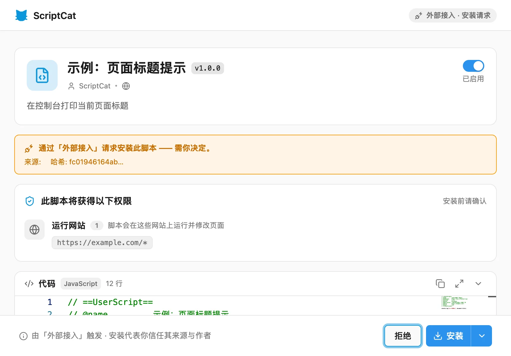

**外部接入**让本机命令行和支持 [MCP](https://modelcontextprotocol.io/) 的 AI 客户端（如 Claude Code、Cursor）
通过 [sctl](https://github.com/scriptscat/sctl) 管理脚本猫中的脚本：列出、读取、搜索、安装、编辑、启用、停用和删除。



- `sctl serve` 是本机常驻的 daemon，命令行和 AI 客户端都通过它访问脚本猫，**需要你手动启动**。
- 脚本猫只需配对一次，之后命令行和所有 AI 客户端共用这条连接。
- 读取源码和写操作是否放行，始终由脚本猫的策略和确认页决定，外部程序不能批准自己的请求。

:::tip sctl 还能控制浏览器
sctl 另有配套的 **sctl Browser** 扩展，可以让命令行和 AI 控制标签页、自动化页面、查看控制台和网络请求。
它与脚本猫分别配对，本文只介绍脚本猫部分，浏览器控制见 [sctl Browser](./sctl-browser.md)。
:::

## 一、安装 sctl

macOS / Linux：

```bash
curl -fsSL https://raw.githubusercontent.com/scriptscat/sctl/main/scripts/install.sh | sh
```

Homebrew：

```bash
brew install scriptscat/tap/sctl
```

Windows（PowerShell）：

```powershell
irm https://raw.githubusercontent.com/scriptscat/sctl/main/scripts/install.ps1 | iex
```

安装脚本会校验发布包的 sha256，把 `sctl` 装到 `~/.local/bin`（macOS / Linux）或 `%LOCALAPPDATA%\sctl\bin`
（Windows）；该目录不在 `PATH` 中时会打印提示，但不会替你修改 shell 配置。也可以从
[GitHub Releases](https://github.com/scriptscat/sctl/releases) 手动下载对应平台的发布包，解压后放进 `PATH`。

安装完成后确认版本：

```bash
sctl version
```

## 二、启动 daemon

在一个终端中运行，并保持它不退出：

```bash
sctl serve
```

daemon 默认只监听本机 `ws://127.0.0.1:8643`。`sctl connect`、`sctl status`、其他命令和 `sctl mcp` 都不会自动
启动它；需要开机常驻时，用操作系统的用户服务管理器托管这条命令即可。

## 三、在脚本猫中配对

1. 打开脚本猫的**设置 → 工具 → 外部接入**，开启右上角开关。**sctl 地址**保持默认的 `ws://127.0.0.1:8643`。
2. 保持 `sctl serve` 运行，在另一个终端执行：

   ```bash
   sctl connect
   ```

   终端会显示一个 8 位配对码，形如 `A1B2-C3D4`。

3. 在脚本猫中点击**接入 sctl**，输入配对码，点击**接入**：

   

4. 卡片显示**已接入**和 sctl 版本即表示完成，也可以在终端确认：

   ```bash
   sctl status
   ```

   

:::warning 配对码只在终端显示
配对码 2 分钟后过期，且只能使用一次，不会经网络发送给扩展。不要把它粘贴到 AI 对话、Issue、日志或 MCP 配置中；
过期后重新运行 `sctl connect` 即可。
:::

## 四、权限与确认 {#permissions}

| 能力 | 默认行为 |
|---|---|
| 读取脚本列表与元数据 | 直接返回 |
| 读取或搜索脚本源码 | 按**源码读取**策略 |
| 安装、编辑、启用、停用或删除脚本 | 按**写操作**策略 |

两项策略都可以在外部接入卡片中切换为「需人工审批」（默认）或「直接允许」。

在「需人工审批」下，请求会在浏览器中打开确认页，命令行或 AI 客户端会一直等待你的决定。安装和编辑请求在脚本
安装页中确认，页面顶部会标明请求来自外部接入，编辑时会显示改动内容：



读取源码、启用、停用和删除请求则打开单独的操作确认页：


- **允许**：只放行这一次。
- **本会话允许**：同一脚本的同类操作在本次浏览器会话内不再询问。浏览器重启、扩展重载或停止外部接入后自动清除。
- **拒绝**：请求方收到拒绝。

请求 5 分钟内没有决定会自动过期；请求方断开或在终端按 `Ctrl-C` 也会作废请求。

:::warning 谨慎使用「直接允许」
「直接允许」会跳过该类操作的确认页。脚本源码中可能包含 API Key、Cookie 等敏感信息，写操作会直接改变脚本，
请只在理解风险后开启。
:::

## 五、命令行用法

```bash
sctl get                         # 列出脚本
sctl get <uuid>                  # 读取元数据
sctl get <uuid> -o source        # 输出完整源码
sctl get <uuid> -o source --lines 20-80
sctl grep <uuid> "fetch("        # 按字面量搜索源码
sctl grep <uuid> "pattern" -E    # 使用正则表达式
sctl install <url|文件>
sctl edit <uuid> --replace OLD --with NEW
sctl enable <uuid>
sctl disable <uuid>
sctl delete <uuid>
```

`grep` 默认按字面量匹配；`-E` 使用正则，`-i` 忽略大小写，`-C N` 返回上下文，`-m N` 限制匹配数。没有匹配不是
错误，退出码仍为 0。

`edit` 按内容锚点修改，而不是按行号：每个 `--replace` 的文本默认必须在脚本中只出现一次，`--replace-all` 可替换
全部匹配。只有改动部分会发送给扩展，不需要先读取或上传整份源码。

需要确认的命令会等待浏览器中的决定，退出码表示结果：

| 退出码 | 含义 |
|---|---|
| `0` | 已批准并成功，或只读命令正常完成 |
| `1` | 在浏览器中被拒绝 |
| `2` | 请求过期、被 `Ctrl-C` 取消或扩展断开 |
| `3` | 参数错误、连接失败、脚本不存在等其他错误 |

加 `-o json` 可输出机器可读的结果；运行 `sctl <命令> --help` 查看完整参数。

## 六、接入 AI 客户端（MCP）

先确认 `sctl serve` 正在运行，且 `sctl status` 显示扩展已连接，然后在 AI 客户端的 MCP 配置中添加：

```json
{
  "mcpServers": {
    "scriptcat": {
      "command": "/absolute/path/to/sctl",
      "args": ["mcp", "--name", "my-ai-client"]
    }
  }
}
```

- `command` 填 sctl 的**绝对路径**（可用 `command -v sctl` 查看）。很多 GUI 应用的 `PATH` 比终端少，也不会展开
  `~`、`$HOME`。
- `--name` 只是写进审计日志的标签，便于区分不同客户端，不是身份认证或权限边界。
- MCP 客户端会自己启动 `sctl mcp`，但不会启动 daemon，`sctl serve` 仍需先运行。
- 不要用会向 stdout 打印内容的脚本包装 sctl：stdout 专用于 MCP 协议帧。

修改配置后重启或重新加载 AI 客户端，然后让它「列出我安装的脚本」验证接入。

脚本相关的工具：

| 工具 | 作用 | 确认策略 |
|---|---|---|
| `scripts_list` | 列出脚本摘要 | 无 |
| `scripts_metadata_get` | 读取单个脚本元数据 | 无 |
| `scripts_source_get` | 按 uuid 和可选行范围读取源码 | 源码读取策略 |
| `scripts_source_grep` | 搜索源码并返回匹配行 | 源码读取策略 |
| `scripts_install_request` | 请求安装脚本 | 写操作策略 |
| `scripts_edit_request` | 请求基于内容锚点编辑脚本 | 写操作策略 |
| `scripts_toggle_request` | 请求启用或停用脚本 | 写操作策略 |
| `scripts_delete_request` | 请求删除脚本 | 写操作策略 |

AI 客户端中还会出现 `browsers_list`、`tabs_list` 等浏览器控制工具，它们属于
[sctl Browser](./sctl-browser.md) 扩展；没有配对 sctl Browser 时调用会返回错误，可以忽略。

如果你的 AI 工具更适合直接调用命令行，也可以不配置 MCP，改为安装 sctl 仓库中的
[agent skill](https://github.com/scriptscat/sctl/tree/main/skills/sctl)。

## 七、审计与撤销

- 外部接入卡片中的**查看审计日志**会打开按外部接入来源过滤的日志页。
- `sctl status` 显示 daemon 版本、扩展连接状态和近期安全事件摘要；加 `-o json` 返回完整事件。
- **停止外部接入**会断开连接、删除扩展侧的配对信息并清除会话授权，再次使用需要重新配对。
- 只想停用某个 AI 客户端时，从该客户端的 MCP 配置中删除 sctl 即可，不影响命令行和其他客户端。

## 八、进阶设置

### 数据目录

daemon、命令行和 MCP 进程必须使用同一个数据目录，其中保存长期配对密钥（`pairing.key`）、本机控制令牌
（`control.token`）和日志。默认使用当前用户的数据目录：

| 平台 | 默认数据目录 |
|---|---|
| macOS | `~/Library/Application Support/sctl/` |
| Windows | `%LOCALAPPDATA%\sctl\` |
| Linux | `~/.config/sctl/` |

所有进程都以同一个用户运行时，保持默认即可。需要自定义时，为**每个** sctl 进程设置同一个绝对路径，MCP 配置
中也要加上：

```bash
export SCTL_DATA_DIR=/absolute/path/to/sctl-data   # 或使用 --data-dir，命令行参数优先
```

```json
"env": { "SCTL_DATA_DIR": "/absolute/path/to/sctl-data" }
```

不要把数据目录放进代码仓库或多人共享的同步目录，也不要把其中的 `pairing.key`、`control.token` 提供给 AI 模型。

### 监听其他地址

如需让其他设备上的浏览器连接，可以显式指定监听地址：

```bash
sctl --listen-address 0.0.0.0:8643 serve
```

此时同一台机器上的 `connect`、`status`、其他命令和 `sctl mcp` 也必须传入相同的 `--listen-address`。脚本猫
中的 **sctl 地址**填写浏览器实际能访问到的地址，例如 `ws://192.168.1.10:8643`，不要填 `0.0.0.0`。

:::warning 只在可信网络中使用
`ws://` 不加密传输内容，也不区分远程客户端。扩展与 daemon 之间仍通过配对得到的长期密钥双向认证，但请只在
可信网络中使用非默认地址。
:::

## 九、排查 {#troubleshooting}

**提示 daemon 不可达**

先运行 `sctl serve`，其他命令不会自动启动 daemon。如果改过监听地址，确认所有命令都传入了相同的
`--listen-address`。

**提示控制通道鉴权失败**

`serve`、命令行和 MCP 进程使用了不同的数据目录。检查 `SCTL_DATA_DIR` 和 `--data-dir`，让它们指向同一个绝对
路径，然后重启 MCP 客户端。

**外部接入卡片显示「连接失败」**

确认 `sctl serve` 正在运行、卡片中的地址与 daemon 一致，并检查安全软件是否拦截了 `127.0.0.1:8643`。从未配对
或已停止外部接入时，重新运行 `sctl connect` 配对。

**AI 客户端中看不到工具**

确认 `command` 是 sctl 的绝对路径、配置文件语法正确，然后重新加载客户端。

**命令长时间不返回**

去浏览器中找确认页并做出决定；不想继续可按 `Ctrl-C` 作废请求。

**查看日志**

日志位于数据目录下的 `logs/`，例如 macOS 默认为 `~/Library/Application Support/sctl/logs/`。
