v1.5 is a full rebuild of the ScriptCat interface: cleaner, more consistent, and easier to use — with dedicated optimizations for mobile so that both desktop and mobile users get a better experience. It also adds External Access, which lets you manage your scripts from the command line and from AI clients through [sctl](https://github.com/scriptscat/sctl). Ideas about the new UI/UX are welcome in the [GitHub Discussions](https://github.com/scriptscat/scriptcat/discussions). For the complete list of changes, see the [changelog](./index.md).

## 💥 External Access: connect the command line and AI clients with sctl [#1573](https://github.com/scriptscat/scriptcat/pull/1573)

[sctl](https://github.com/scriptscat/sctl) is ScriptCat's companion local bridge, a single cross-platform executable. Once you pair it with a one-time code under **Tools → External Access**, the `sctl` command in your terminal and [MCP](https://modelcontextprotocol.io/)-capable AI clients such as Claude Code can manage the scripts in ScriptCat: list scripts, read and search source by line ranges, install, edit by content anchors, enable, disable and delete.



**The browser stays in charge.** Reading source and every write require approval on a confirmation page ScriptCat opens — Reject, Allow, or Allow for this session — and each category can be switched to allow without asking in the permission policy. External programs cannot approve their own requests, and every operation is recorded in an audit log you can open with "View audit log" on the External Access card. By default sctl only talks over this machine (port 8643); the extension and sctl authenticate each other with a long-term key established at pairing, and no Native Messaging host is needed.

**Not just scripts.** sctl also ships its own **sctl Browser** extension. Once it is installed and paired, you can control tabs and windows from the command line, manage bookmarks, history, downloads, cookies and other browser data, automate pages with accessibility snapshots (click, fill, screenshot and more), inspect console messages and network requests, or open a CDP endpoint for Playwright / Puppeteer to connect to.

Quick start:

```bash
# macOS / Linux
curl -fsSL https://raw.githubusercontent.com/scriptscat/sctl/main/scripts/install.sh | sh
# Windows PowerShell
irm https://raw.githubusercontent.com/scriptscat/sctl/main/scripts/install.ps1 | iex

sctl serve      # start the local daemon and keep it running
sctl connect    # in another terminal; enter the printed code under Tools → External Access in ScriptCat
sctl status     # confirm the connection
```

See [External Access](/docs/use/external-access/) for the data directory, MCP client configuration, revoking access and security notes.

## A Brand-New Interface [#1514](https://github.com/scriptscat/scriptcat/pull/1514)

The entire interface has been fully rebuilt, with a more consistent visual style, clearer hierarchy, and full light/dark theme support. The script list offers both table and card views, together with advanced filtering by status, type, tag, and source — so managing a lot of scripts stays comfortable.


## Mobile Optimizations

The layout is now purpose-built for mobile browsers that support extensions (such as Edge for Android and Kiwi): the script list is shown as cards, a bottom navigation bar is provided, a left-side drawer gives quick access to Subscriptions, Logs, Tools, and Settings, and the extension popup adapts to narrow screens.


## 💥 Network Rules (DNR) [#1598](https://github.com/scriptscat/scriptcat/pull/1598)

Under Tools → Network rules you can manage, per domain, how the browser handles matching requests: strip
CSP / X-Frame-Options and other response headers, rewrite request and response headers, block requests, or
redirect them elsewhere. Priority follows the list order, so rules can be reordered by dragging, enabled,
disabled, or deleted in bulk, and the footer shows live dynamic-rule quota usage.

If a userscript is blocked by a site's CSP or Trusted Types restrictions, see [CSP / Trusted Types troubleshooting](/docs/use/QA/#csp-trusted-types) for guidance on creating a site-specific "Remove CSP" rule and understanding its security impact.


The edit drawer offers both common scenario templates and a custom entry point. Request headers that would leak
or forge the caller's identity — Cookie, Authorization, Host and Origin — can never be modified, and the "All
websites" scope is treated as high risk and asks for confirmation before saving. Once a rule is filled in, "Try
a URL" shows how a given address would be handled.


## 💥 Script Recycle Bin [#1585](https://github.com/scriptscat/scriptcat/pull/1585)

Deleted scripts are no longer destroyed immediately — they go to the recycle bin first, supporting **restore** (preserving the original script data and permissions), permanent delete, and retention-based auto-cleanup. The retention period defaults to 30 days and is adjustable in settings, or can be set to never.

## 💥 Official Firefox MV3 Support [#1561](https://github.com/scriptscat/scriptcat/pull/1561)

With improved sandbox / offscreen communication, ScriptCat MV3 now officially supports the Firefox browser.

## Redesigned Install and Update Pages [#1742](https://github.com/scriptscat/scriptcat/pull/1742) [#1732](https://github.com/scriptscat/scriptcat/pull/1732)

Before you install a script you can see which directives, values and GM capabilities are written but have no effect in ScriptCat, and ScriptCat-only capabilities are marked separately. When a script updates, permissions are shown as a diff against the installed version, with unchanged items collapsed so only what is new or changed stands out; the code can be viewed full-screen [#1743](https://github.com/scriptscat/scriptcat/pull/1743).

## Custom New-Script Templates [#1731](https://github.com/scriptscat/scriptcat/pull/1731)

Under Settings → Development Tools → Script Templates you can set the initial code for new normal, background and scheduled scripts separately, with variables such as `{{name}}`, `{{match}}` and `{{date:YYYY-MM-DD}}`.

## Choose Script Type from the Editor [#1544](https://github.com/scriptscat/scriptcat/pull/1544)

The editor tab bar's "＋" now lets you pick the type of script to create (normal / background / scheduled) directly, without returning to the list page.

## Manual Download for Local Backups [#1543](https://github.com/scriptscat/scriptcat/pull/1543)

Local backups now offer a manual download link to export the backup file directly to your device.

## structured_clone Messaging on Chromium 148+ [#1534](https://github.com/scriptscat/scriptcat/pull/1534)

On Chromium 148+, internal extension messages use `structured_clone` serialization, supporting a wider range of data types.

## Other Improvements

- **GM API**: native `GM_download` now honors `@connect`, consistent with `GM_xmlhttpRequest` [#1506](https://github.com/scriptscat/scriptcat/pull/1506)
- **Performance**: improved script-loading cache and fixed leftover popup menus [#1511](https://github.com/scriptscat/scriptcat/pull/1511)
- **Editor**: adjusted the `eslint-plugin-userscripts` rules [#1510](https://github.com/scriptscat/scriptcat/pull/1510)
- **Fix**: avoid scheduled-task issues caused by cron auto-detecting an invalid time zone [#1531](https://github.com/scriptscat/scriptcat/pull/1531)
- **Fix**: replace an unavailable demo API in the crontab example [#1542](https://github.com/scriptscat/scriptcat/pull/1542)
- **GM API**: support the `@exclude-match` metadata key [#1798](https://github.com/scriptscat/scriptcat/pull/1798); `GM_info` gains `userLanguage` [#1799](https://github.com/scriptscat/scriptcat/pull/1799)
- **Popup**: site-scope quick actions, always visible and reversible [#1646](https://github.com/scriptscat/scriptcat/pull/1646) [#1666](https://github.com/scriptscat/scriptcat/pull/1666) [#1696](https://github.com/scriptscat/scriptcat/pull/1696)
- **Batch update**: updates are split into "Related" (current site) and "Other updates" [#1788](https://github.com/scriptscat/scriptcat/pull/1788)
- **Editor**: the resource panel previews cached resources and flags unsupported `@grant` values and duplicate `@resource` names [#1758](https://github.com/scriptscat/scriptcat/pull/1758) [#1763](https://github.com/scriptscat/scriptcat/pull/1763) [#1762](https://github.com/scriptscat/scriptcat/pull/1762)
- **i18n**: added Korean, Turkish, and Brazilian Portuguese
